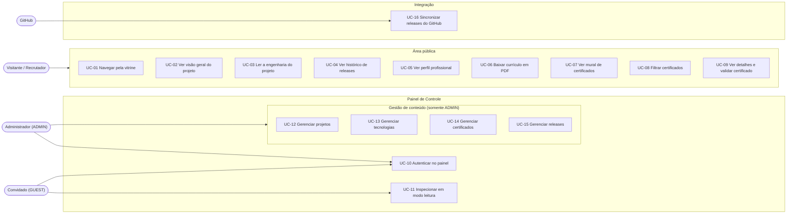

# Casos de Uso: Portfólio & Sistema de Gerenciamento

> Documento da **Fase 1 (planejamento)**. Descreve como cada perfil de acesso interage com o sistema.
> Veja também: [`escopo.md`](./escopo.md) · [`modelo-conceitual.md`](./modelo-conceitual.md) · [`requisitos.md`](./requisitos.md)

---

## 1. Visão Geral

Este documento descreve **quem** usa o sistema, **o que** cada um consegue fazer e **como** a interação acontece, passo a passo.

Cada caso de uso é identificado por um código (`UC-01`, `UC-02`...) e segue o mesmo formato:

- **Ator, módulo e pré-condições:** quem executa, em qual parte do sistema e o que precisa estar pronto antes.
- **Fluxo principal:** o caminho normal, do início ao fim.
- **Fluxos alternativos e de exceção:** o que acontece quando algo foge do caminho normal.
- **Pós-condições:** o estado do sistema ao final.

Os códigos `UC-xx` serão usados em [`requisitos.md`](./requisitos.md) para ligar cada requisito ao caso de uso que o origina.

---

## 2. Atores

| Ator | Tipo | Autenticação | O que pode fazer |
|---|---|---|---|
| **Visitante / Recrutador** | Primário | Não | Consultar todo o conteúdo público: projetos, perfil, certificados e currículo. |
| **Convidado (`GUEST`)** | Primário | Sim, papel `GUEST` | Entrar no painel e inspecionar as telas em modo leitura, sem alterar nenhum dado. |
| **Administrador (`ADMIN`)** | Primário | Sim, papel `ADMIN` | Tudo o que o convidado vê, mais a gestão completa de projetos, tecnologias, certificados e releases. |
| **GitHub** | Secundário (sistema externo) | Requisição validada pelo sistema | Envia automaticamente os dados de novas releases por Webhook ou GitHub Action. |

---

## 3. Mapa dos Casos de Uso

| ID | Caso de uso | Ator | Módulo | Entidades envolvidas |
|---|---|---|---|---|
| UC-01 | Navegar pela vitrine de projetos | Visitante | Central de Projetos | `Projetos`, `Tecnologias` |
| UC-02 | Consultar a visão geral de um projeto | Visitante | Central de Projetos | `Projetos`, `Tecnologias` |
| UC-03 | Ler a engenharia por trás do projeto | Visitante | Central de Projetos | `Projetos` |
| UC-04 | Consultar o histórico de releases | Visitante | Central de Projetos | `Projetos`, `Releases` |
| UC-05 | Consultar o perfil profissional | Visitante | Perfil & Currículo | `Perfil`, `Tecnologias` |
| UC-06 | Baixar o currículo em PDF | Visitante | Perfil & Currículo | `Perfil` |
| UC-07 | Consultar o mural de certificados | Visitante | Certificados & Formação | `Certificados` |
| UC-08 | Filtrar certificados por categoria | Visitante | Certificados & Formação | `Certificados` |
| UC-09 | Consultar detalhes e validar um certificado | Visitante | Certificados & Formação | `Certificados` |
| UC-10 | Autenticar no painel | Convidado, Administrador | Painel de Controle | `Usuarios` |
| UC-11 | Inspecionar o painel em modo leitura | Convidado | Painel de Controle | `Usuarios` e todas as entidades (leitura) |
| UC-12 | Gerenciar projetos | Administrador | Painel de Controle | `Projetos`, `Projeto_Tecnologias`, `Perfil` |
| UC-13 | Gerenciar tecnologias | Administrador | Painel de Controle | `Tecnologias` |
| UC-14 | Gerenciar certificados | Administrador | Painel de Controle | `Certificados`, `Perfil` |
| UC-15 | Gerenciar releases (cadastro manual) | Administrador | Painel de Controle | `Releases`, `Projetos` |
| UC-16 | Sincronizar releases do GitHub | GitHub | Central de Projetos (integração) | `Releases`, `Projetos` |

---

## 4. Casos de Uso do Visitante / Recrutador

O visitante **não precisa de login**. O menu do portfólio mantém sempre visíveis os acessos a **Projetos**, **Perfil & Currículo** e **Certificados**, de modo que qualquer um deles está a **1 clique** de distância a partir de qualquer tela.

### UC-01 Navegar pela vitrine de projetos

- **Ator:** Visitante / Recrutador
- **Módulo:** Central de Projetos
- **Pré-condição:** nenhuma (acesso público).
- **Pós-condição:** o visitante visualiza a lista de projetos.

**Fluxo principal**

1. O visitante acessa o portfólio e abre a Central de Projetos pelo menu.
2. O sistema exibe os projetos em cards, cada um com capa, título, resumo e tecnologias utilizadas.
3. Os projetos marcados como destaque aparecem fixados no topo da vitrine.

**Fluxos alternativos**

- **2a.** Se não houver nenhum projeto cadastrado, o sistema exibe a vitrine em estado vazio, sem mensagem de erro.

---

### UC-02 Consultar a visão geral de um projeto

- **Ator:** Visitante / Recrutador
- **Módulo:** Central de Projetos
- **Pré-condição:** existe ao menos um projeto cadastrado.
- **Pós-condição:** o visitante conhece o que o projeto resolve e pode acessá-lo ao vivo ou ver o código.

**Fluxo principal**

1. O visitante clica em um card da vitrine.
2. O sistema abre a página do projeto, identificada pelo seu endereço amigável (*slug*).
3. O sistema exibe a **Visão Geral**: descrição detalhada, imagem ou GIF da interface, tecnologias utilizadas, link do deploy e link do repositório no GitHub.
4. O visitante abre o deploy (aplicação rodando ao vivo) ou o repositório (código-fonte), se desejar.

**Fluxos alternativos**

- **2a.** Se o endereço informado não corresponder a nenhum projeto, o sistema exibe uma página de "projeto não encontrado" com acesso de volta à vitrine.
- **3a.** Se o projeto não tiver deploy publicado, o sistema oculta o link correspondente.

---

### UC-03 Ler a engenharia por trás do projeto

- **Ator:** Visitante / Recrutador
- **Módulo:** Central de Projetos
- **Pré-condição:** o visitante está na página de um projeto (UC-02).
- **Pós-condição:** o visitante entende como o projeto foi construído e por quê.

**Fluxo principal**

1. Na página do projeto, o visitante abre a seção **A Engenharia por Trás ("Como Fiz")**.
2. O sistema exibe a **Arquitetura do Sistema**: como o front-end se comunica com o back-end e o banco de dados, a organização de pastas, o fluxo de dados e os padrões de projeto.
3. O sistema exibe os **Desafios Técnicos & Soluções**: o maior problema enfrentado e como foi resolvido.
4. O sistema exibe as **Decisões de Tecnologia**: por que determinada tecnologia foi escolhida em vez de outra.
5. O visitante lê o conteúdo e, se quiser, segue para o histórico de releases (UC-04).

**Fluxos alternativos**

- **2a.** Se alguma subseção ainda não tiver conteúdo, o sistema a exibe em estado vazio, sem mensagem de erro.

---

### UC-04 Consultar o histórico de releases

- **Ator:** Visitante / Recrutador
- **Módulo:** Central de Projetos
- **Pré-condição:** o visitante está na página de um projeto (UC-02).
- **Pós-condição:** o visitante visualiza a evolução do projeto ao longo das versões.

**Fluxo principal**

1. Na página do projeto, o visitante abre a aba **Versões / Histórico de Releases**.
2. O sistema lista as releases do projeto, da mais recente para a mais antiga.
3. Cada release mostra a **versão** (ex.: `v0.1.0`), a **data de lançamento** e o **changelog** (o que mudou, correções e novas funcionalidades).

**Fluxos alternativos**

- **2a.** Se o projeto ainda não tiver nenhuma release, o sistema exibe a aba em estado vazio, sem mensagem de erro.

---

### UC-05 Consultar o perfil profissional

- **Ator:** Visitante / Recrutador
- **Módulo:** Perfil & Currículo Destaque
- **Pré-condição:** existe um perfil cadastrado.
- **Pós-condição:** o visitante conhece o profissional e sabe como contatá-lo.

**Fluxo principal**

1. O visitante abre **Perfil & Currículo** pelo menu.
2. O sistema exibe o resumo profissional: nome completo, cargo ou título principal, biografia e principais especialidades.
3. O sistema exibe os links de contato rápido: LinkedIn, GitHub e e-mail.
4. O sistema exibe as habilidades agrupadas por área: Front-end, Back-end, Banco de Dados e Ferramentas / DevOps.
5. O visitante clica em um canal de contato para abri-lo (perfil externo ou programa de e-mail).

---

### UC-06 Baixar o currículo em PDF

- **Ator:** Visitante / Recrutador
- **Módulo:** Perfil & Currículo Destaque
- **Pré-condição:** o perfil possui um currículo em PDF disponível.
- **Pós-condição:** o visitante tem o currículo atualizado em seu dispositivo.

**Fluxo principal**

1. De qualquer tela do portfólio, o visitante clica no botão **Baixar currículo**. *(1 clique)*
2. O sistema entrega o arquivo PDF mais atualizado.
3. O download é iniciado.

**Fluxos alternativos**

- **2a.** Se o arquivo estiver indisponível, o sistema informa o problema e mantém o visitante na página em que estava.

---

### UC-07 Consultar o mural de certificados

- **Ator:** Visitante / Recrutador
- **Módulo:** Certificados & Formação
- **Pré-condição:** nenhuma (acesso público).
- **Pós-condição:** o visitante visualiza as formações e certificações.

**Fluxo principal**

1. O visitante abre **Certificados & Formação** pelo menu.
2. O sistema exibe o mural com todos os certificados, cada um com título, instituição emissora, categoria e data de emissão. A grade do curso não aparece no mural: ela é exibida nos detalhes do certificado (UC-09).

**Fluxos alternativos**

- **2a.** Se não houver nenhum certificado cadastrado, o sistema exibe o mural em estado vazio, sem mensagem de erro.

---

### UC-08 Filtrar certificados por categoria

- **Ator:** Visitante / Recrutador
- **Módulo:** Certificados & Formação
- **Pré-condição:** o visitante está no mural de certificados (UC-07).
- **Pós-condição:** o mural exibe apenas os certificados da categoria escolhida.

**Fluxo principal**

1. No mural, o visitante escolhe uma categoria no filtro (ex.: *Backend* ou *DevOps*).
2. O sistema atualiza o mural, exibindo apenas os certificados daquela categoria.
3. O visitante troca de categoria ou limpa o filtro para voltar a ver todos os certificados.

**Fluxos alternativos**

- **2a.** Se nenhum certificado pertencer à categoria escolhida, o sistema informa que não há resultados e mantém o filtro disponível para nova escolha.

---

### UC-09 Consultar detalhes e validar um certificado

- **Ator:** Visitante / Recrutador
- **Módulo:** Certificados & Formação
- **Pré-condição:** o visitante está no mural de certificados (UC-07).
- **Pós-condição:** o visitante conhece o conteúdo do curso e confirma a autenticidade do certificado.

**Fluxo principal**

1. O visitante seleciona um certificado no mural.
2. O sistema abre um **modal de detalhes**, sem sair da página, com a **grade do curso** (o que foi ensinado) e os meios de validação disponíveis:
   - **Comprovante:** a imagem da credencial ou do diploma.
   - **Verificação oficial:** o link da credencial no site da instituição ou plataforma emissora.
3. O visitante confere a grade e valida a autenticidade vendo o comprovante no próprio modal ou abrindo o link de verificação oficial, que leva ao site do emissor.
4. O visitante fecha o modal ou retorna do site externo e continua navegando pelo mural.

**Fluxos alternativos**

- **2a.** Se o certificado tiver apenas uma das formas de validação, o modal exibe somente a que estiver disponível.
- **2b.** Se o certificado não tiver grade cadastrada, o modal omite essa parte, sem mensagem de erro.

---

## 5. Casos de Uso de Autenticação e do Convidado

### UC-10 Autenticar no painel

- **Ator:** Convidado (`GUEST`) ou Administrador (`ADMIN`)
- **Módulo:** Painel de Controle
- **Pré-condição:** nenhuma para o convidado. O administrador precisa ter uma conta cadastrada.
- **Pós-condição:** sessão iniciada com o papel correspondente (`ADMIN` ou `GUEST`).

**Fluxo principal (administrador)**

1. O usuário acessa a área do painel de controle.
2. O sistema exibe a tela de login, com campos de e-mail e senha e a opção **Entrar como convidado**.
3. O administrador informa e-mail e senha.
4. O sistema valida as credenciais e identifica o papel `ADMIN` da conta.
5. O sistema abre o painel com permissão de leitura e escrita.

**Fluxo alternativo: entrada como convidado**

- **3a.** O usuário escolhe **Entrar como convidado**. O sistema autentica a conta de papel `GUEST` e segue para o passo 5, abrindo o painel com permissão somente de leitura.

**Fluxos de exceção**

- **4a.** Se as credenciais forem inválidas, o sistema recusa o acesso, informa que e-mail ou senha estão incorretos (sem indicar qual dos dois) e mantém o usuário na tela de login.
- **1a.** Se alguém tentar abrir diretamente uma tela do painel sem estar autenticado, o sistema redireciona para a tela de login.

---

### UC-11 Inspecionar o painel em modo leitura

- **Ator:** Convidado (`GUEST`)
- **Módulo:** Painel de Controle
- **Pré-condição:** autenticado como `GUEST` (UC-10).
- **Pós-condição:** o convidado conhece a interface administrativa e nenhum dado foi alterado.

**Fluxo principal**

1. O convidado navega pelas áreas do painel: projetos, tecnologias, certificados e releases.
2. O sistema exibe as listagens e os registros em modo leitura.
3. O convidado abre um registro ou um formulário para ver como a edição funciona na prática.
4. O convidado sai das telas sem alterar nada.

**Fluxos de exceção**

- **3a.** Se o convidado tentar criar, editar ou excluir qualquer registro, o sistema recusa a ação, informa que o acesso é somente leitura e **nenhum dado é alterado**.
- A interface pode desabilitar ou ocultar as ações de escrita para o convidado, mas a recusa é **sempre aplicada pelo servidor**, independentemente do que a interface mostre.

---

## 6. Casos de Uso do Administrador

Em todos os casos desta seção, a **pré-condição** inclui estar autenticado como `ADMIN` (UC-10). As ações de gestão ficam disponíveis somente para esse papel.

### UC-12 Gerenciar projetos

- **Ator:** Administrador (`ADMIN`)
- **Módulo:** Painel de Controle
- **Pós-condição:** o projeto é criado, atualizado ou removido e a vitrine pública reflete a mudança.

**Fluxo principal: criar projeto**

1. O administrador abre **Projetos** no painel e o sistema lista os projetos existentes.
2. O administrador escolhe **Novo projeto**.
3. O administrador preenche: título, *slug*, resumo, descrição detalhada, notas de arquitetura, decisões de tecnologia, desafios e soluções, link do deploy, link do repositório, nome exato do repositório no GitHub, capa e se o projeto é destaque.
4. O administrador seleciona as tecnologias utilizadas (no mínimo 1).
5. O administrador salva. O sistema valida os dados, registra o projeto vinculado ao perfil e preenche as datas de criação e de última alteração.
6. O sistema confirma o cadastro e o projeto passa a aparecer na vitrine (UC-01).

**Fluxo alternativo: editar projeto**

- **E1.** O administrador seleciona um projeto da lista e altera os campos ou as tecnologias associadas.
- **E2.** Ao salvar, o sistema valida os dados e atualiza o registro e a data de última alteração.

**Fluxo alternativo: excluir projeto**

- **X1.** O administrador seleciona um projeto e escolhe **Excluir**.
- **X2.** O sistema pede confirmação, informando os registros que serão afetados (por exemplo, o histórico de releases do projeto).
- **X3.** Ao confirmar, o sistema remove o projeto, que deixa de aparecer na vitrine. Se o administrador cancelar, nada é alterado.

**Fluxo alternativo: destacar projeto**

- **D1.** O administrador marca ou desmarca a opção **Destaque** de um projeto. Projetos em destaque ficam fixados no topo da vitrine.

**Fluxos de exceção**

- **5a.** Se nenhuma tecnologia estiver selecionada, o sistema recusa o salvamento e solicita ao menos 1 tecnologia.
- **5b.** Se o *slug* informado já estiver em uso por outro projeto, o sistema recusa o salvamento e solicita outro.
- **5c.** Se algum campo obrigatório estiver vazio, o sistema recusa o salvamento e indica quais campos precisam ser preenchidos.

---

### UC-13 Gerenciar tecnologias

- **Ator:** Administrador (`ADMIN`)
- **Módulo:** Painel de Controle
- **Pós-condição:** o catálogo de tecnologias está atualizado e disponível para associação aos projetos.

**Fluxo principal: criar tecnologia**

1. O administrador abre **Tecnologias** no painel e o sistema lista o catálogo.
2. O administrador escolhe **Nova tecnologia**.
3. O administrador informa nome, categoria (*Frontend*, *Backend*, *Banco de Dados* ou *DevOps/Ferramentas*) e ícone.
4. O administrador salva e o sistema registra a tecnologia, que passa a poder ser associada a projetos e a aparecer nas habilidades do perfil (UC-05).

**Fluxo alternativo: editar tecnologia**

- **E1.** O administrador seleciona uma tecnologia, altera nome, categoria ou ícone e salva. A mudança vale para todos os projetos que a utilizam.

**Fluxo alternativo: excluir tecnologia**

- **X1.** O administrador seleciona uma tecnologia e escolhe **Excluir**.
- **X2.** O sistema pede confirmação e, ao confirmar, remove a tecnologia do catálogo.

**Fluxos de exceção**

- **X2a.** Se a tecnologia estiver associada a algum projeto, o sistema recusa a exclusão e informa quais projetos a utilizam, pois todo projeto precisa ter ao menos 1 tecnologia.
- **4a.** Se algum campo obrigatório estiver vazio, o sistema recusa o salvamento e indica o que falta.

---

### UC-14 Gerenciar certificados

- **Ator:** Administrador (`ADMIN`)
- **Módulo:** Painel de Controle
- **Pós-condição:** o mural público de certificados reflete a mudança.

**Fluxo principal: criar certificado**

1. O administrador abre **Certificados** no painel e o sistema lista os certificados cadastrados.
2. O administrador escolhe **Novo certificado**.
3. O administrador informa título, instituição emissora, categoria (*Frontend*, *Backend*, *Banco de Dados*, *DevOps/Cloud*, *Arquitetura* ou *Outros*), data de emissão, grade do curso, link de validação oficial e/ou imagem do comprovante.
4. O administrador salva. O sistema valida os dados e registra o certificado vinculado ao perfil.
5. O certificado passa a aparecer no mural (UC-07) e nos filtros por categoria (UC-08).

**Fluxo alternativo: editar certificado**

- **E1.** O administrador seleciona um certificado, altera os campos e salva. O mural passa a exibir os dados atualizados.

**Fluxo alternativo: excluir certificado**

- **X1.** O administrador seleciona um certificado e escolhe **Excluir**.
- **X2.** O sistema pede confirmação e, ao confirmar, remove o certificado do mural.

**Fluxos de exceção**

- **4a.** Se não houver nem link de validação nem imagem do comprovante, o sistema recusa o salvamento e solicita ao menos um dos dois.
- **4b.** Se algum campo obrigatório estiver vazio, o sistema recusa o salvamento e indica o que falta.

---

### UC-15 Gerenciar releases (cadastro manual)

- **Ator:** Administrador (`ADMIN`)
- **Módulo:** Painel de Controle
- **Pré-condição adicional:** o projeto ao qual a release pertence já está cadastrado.
- **Pós-condição:** o histórico de versões do projeto está atualizado.

**Fluxo principal: criar release**

1. O administrador abre um projeto no painel e acessa o seu histórico de releases.
2. O administrador escolhe **Nova release**.
3. O administrador informa a versão (ex.: `v0.2.0`), o changelog e a data de lançamento.
4. O administrador salva. O sistema registra a release vinculada ao projeto.
5. A release passa a aparecer no histórico público do projeto (UC-04).

**Fluxo alternativo: editar release**

- **E1.** O administrador seleciona uma release, ajusta versão, changelog ou data e salva. Isso também permite complementar uma release que chegou do GitHub (UC-16).

**Fluxo alternativo: excluir release**

- **X1.** O administrador seleciona uma release e escolhe **Excluir**.
- **X2.** O sistema pede confirmação e, ao confirmar, remove a release do histórico.

**Fluxos de exceção**

- **4a.** Se algum campo obrigatório estiver vazio, o sistema recusa o salvamento e indica o que falta.
- Toda release é criada dentro do contexto de um projeto. Não é possível cadastrar uma release sem projeto.

---

## 7. Caso de Uso do Sistema Externo

### UC-16 Sincronizar releases do GitHub

- **Ator:** GitHub (sistema externo, via Webhook ou GitHub Action)
- **Módulo:** Central de Projetos (integração)
- **Pré-condição:** o projeto está cadastrado com o nome exato do seu repositório no GitHub, e o Webhook ou a GitHub Action está configurado nesse repositório.
- **Pós-condição:** a release aparece no histórico do projeto, sem intervenção do administrador.

**Fluxo principal**

1. Uma nova release (tag de versão) é criada no repositório do GitHub.
2. O GitHub envia os dados da release ao sistema, por Webhook ou GitHub Action.
3. O sistema verifica se a requisição é legítima.
4. O sistema identifica o projeto pelo nome exato do repositório.
5. O sistema verifica se aquela release (pelo identificador do GitHub) já foi registrada.
6. O sistema registra a release com versão, changelog, data de lançamento e identificador do GitHub.
7. A release passa a aparecer no histórico do projeto (UC-04).

**Fluxos de exceção**

- **3a.** Se a requisição não for legítima, o sistema a rejeita e nada é registrado.
- **4a.** Se nenhum projeto corresponder ao repositório informado, o sistema descarta o evento, pois toda release precisa pertencer a um projeto.
- **5a.** Se a release já existir, o sistema não cria outra: o histórico nunca recebe a mesma release duas vezes.

---

## 8. Cenários de Uso

Exemplos de como os casos de uso se combinam no dia a dia.

**Cenário 1: recrutador com pouco tempo.** Ao receber o link do portfólio, o recrutador clica em **Baixar currículo** e já tem o PDF (UC-06). Em seguida abre **Certificados**, filtra por *Backend* (UC-08) e abre os detalhes de um curso, onde confere a grade e o diploma para validar a autenticidade (UC-09).

**Cenário 2: desenvolvedor avaliando a maturidade técnica.** Na vitrine, abre um projeto em destaque (UC-01, UC-02), lê a arquitetura, os desafios e as decisões de tecnologia (UC-03) e confere no histórico de releases como o projeto evoluiu (UC-04).

**Cenário 3: curioso querendo ver o painel por dentro.** Escolhe **Entrar como convidado** (UC-10), percorre as telas de projetos, tecnologias, certificados e releases (UC-11) e tenta excluir um projeto. O sistema recusa a ação e informa que o acesso é somente leitura, e nenhum dado do autor é alterado.

**Cenário 4: administrador publicando um novo projeto.** Autentica no painel (UC-10), cadastra as tecnologias que ainda não existem (UC-13) e cria o projeto associando ao menos uma delas (UC-12). Quando cria a tag `v0.1.0` no GitHub, a release chega ao sistema sozinha (UC-16) e o administrador, se quiser, complementa o changelog manualmente (UC-15). Por fim, adiciona um certificado recém-concluído (UC-14).

---

## 9. Premissas e Pontos em Aberto

1. **Entrada do convidado.** Foi assumida uma opção **Entrar como convidado** na tela de login, que autentica direto a conta `GUEST`. A alternativa seria divulgar as credenciais dessa conta para quem quiser testar o painel.
2. **Edição do Perfil.** Seguindo o [`escopo.md`](./escopo.md), não há caso de uso para o administrador editar o perfil (biografia, especialidades, links e currículo) pelo painel.
3. **Detalhes formais.** O que acontece com registros dependentes na exclusão, a validação das requisições do GitHub e as demais restrições técnicas serão definidos como requisitos e regras de negócio em [`requisitos.md`](./requisitos.md).
4. **Estados vazios.** Foi assumido que listas e seções sem conteúdo são exibidas em estado vazio, sem mensagem de erro para o visitante.