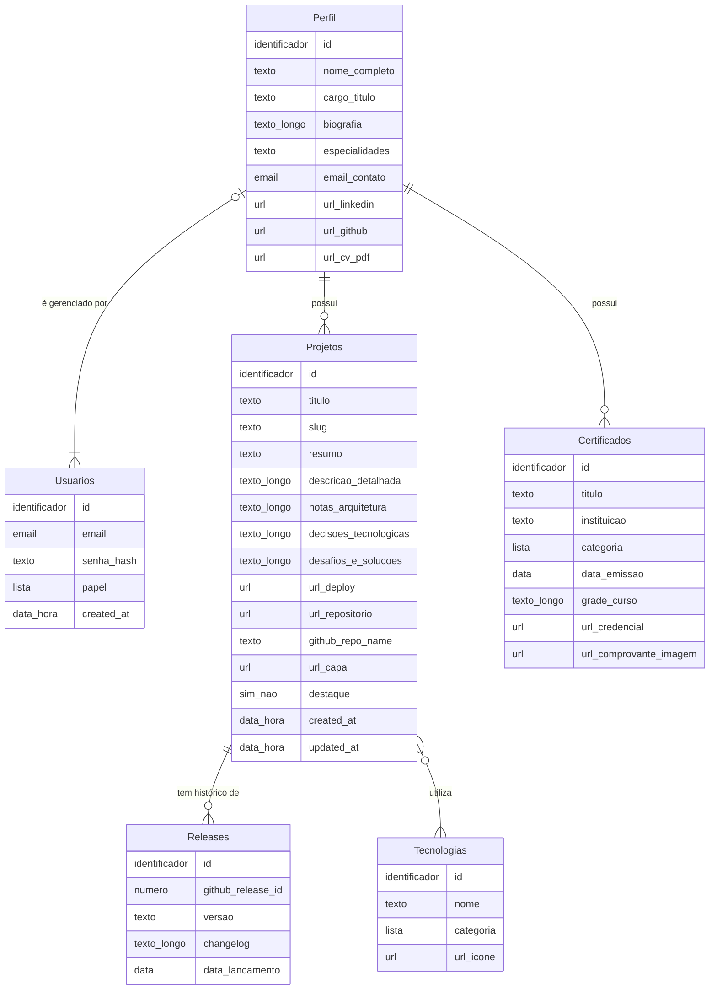

# Modelo Conceitual: Portfólio & Sistema de Gerenciamento

> Documento da **Fase 1 (planejamento)**. Descreve o que o sistema precisa guardar (entidades e atributos) e como as entidades se relacionam (cardinalidades), **sem entrar em detalhes de implementação**. Chaves estrangeiras, tipos específicos de banco e restrições técnicas ficam para a fase de implementação.
>
> Veja também: [`escopo.md`](./escopo.md) · [`casos-de-uso.md`](./casos-de-uso.md) · [`requisitos.md`](./requisitos.md)

---

## 1. Visão Geral

O modelo conceitual descreve as informações do portfólio e como elas se relacionam, de forma independente de banco de dados ou tecnologia.

Ele é composto por **7 elementos** que sustentam os 4 módulos do sistema (ver [`escopo.md`](./escopo.md)).

| # | Elemento | Papel no sistema | Módulo atendido |
|---|---|---|---|
| 1 | `Projetos` | Aplicações do portfólio, com arquitetura, desafios e links. | Central de Projetos |
| 2 | `Releases` | Histórico de versões de cada projeto (a partir das tags do GitHub). | Central de Projetos |
| 3 | `Tecnologias` | Catálogo de linguagens, frameworks e ferramentas. | Central de Projetos e Perfil |
| 4 | `Projeto_Tecnologias` | Associativa que materializa o relacionamento N:N entre projetos e tecnologias. | Central de Projetos |
| 5 | `Certificados` | Mural de cursos e certificações. | Certificados & Formação |
| 6 | `Perfil` | Resumo profissional, currículo e canais de contato. | Perfil & Currículo |
| 7 | `Usuarios` | Contas de acesso ao painel (`ADMIN` e `GUEST`). | Painel de Controle |

---

## 2. Convenções

### 2.1 Notação das cardinalidades `(min, max)`

A cardinalidade **A ↔ B** indica **quantas ocorrências de B** se associam a **cada ocorrência de A**:

- `min` = `0`: a associação é **opcional**. `min` = `1`: é **obrigatória**.
- `max` = `1`: no máximo uma ocorrência. `max` = `N`: várias.

Exemplo: `Perfil ↔ Projeto: (0, N)` significa que cada perfil tem de zero a vários projetos.

### 2.2 Tipos de atributo

Os tipos abaixo são **conceituais**. Tamanhos, tipos específicos do banco e obrigatoriedade técnica serão definidos na implementação.

| Tipo | Significado |
|---|---|
| Identificador | Valor único que distingue cada ocorrência da entidade. |
| Texto | Texto curto (nomes, títulos, rótulos). |
| Texto longo | Texto extenso (descrições, notas, changelog). |
| Número | Valor numérico inteiro. |
| URL | Endereço web (link, imagem ou arquivo). |
| E-mail | Endereço de e-mail. |
| Data | Dia, mês e ano. |
| Data e hora | Momento exato (dia e horário). |
| Sim/Não | Valor verdadeiro ou falso. |
| Lista de valores | Um valor escolhido dentre um conjunto definido. |

---

## 3. Entidades e Atributos

### 3.1 `Projetos`

Armazena a inteligência de engenharia, a arquitetura e os detalhes de cada aplicação.

| Atributo | Tipo | Descrição |
|---|---|---|
| `id` | Identificador | Identificador único do projeto. |
| `titulo` | Texto | Nome do projeto. |
| `slug` | Texto | Identificador amigável na URL (ex.: `gerenciador-de-projetos-web`). Não se repete entre projetos. |
| `resumo` | Texto | Descrição curta para os cards da vitrine. |
| `descricao_detalhada` | Texto longo | Visão geral e proposta da aplicação. |
| `notas_arquitetura` | Texto longo | Engenharia por trás: arquitetura de pastas, fluxo de dados e padrões de projeto. |
| `decisoes_tecnologicas` | Texto longo | Por que cada tecnologia do projeto foi escolhida em vez de outra. |
| `desafios_e_solucoes` | Texto longo | Maior desafio técnico enfrentado e a estratégia usada para resolvê-lo. |
| `url_deploy` | URL | Link da aplicação rodando ao vivo. |
| `url_repositorio` | URL | Link do código-fonte no GitHub. |
| `github_repo_name` | Texto | Nome exato do repositório no GitHub, usado para vincular o Webhook do GitHub ao projeto. |
| `url_capa` | URL | Imagem ou GIF demonstrativo da interface. |
| `destaque` | Sim/Não | Se verdadeiro, fixa o projeto no topo da vitrine. |
| `created_at` | Data e hora | Criação do registro. |
| `updated_at` | Data e hora | Última alteração do registro. |

---

### 3.2 `Releases`

Histórico de versões (*controlling*), gerado a partir das tags de release (iniciando em `v0.1.0`) e alimentado pelo Webhook do GitHub ou pelo formulário interno.

| Atributo | Tipo | Descrição |
|---|---|---|
| `id` | Identificador | Identificador único da release. |
| `github_release_id` | Número | ID original gerado pelo GitHub, usado para evitar duplicidade. Não existe nas releases cadastradas manualmente pelo formulário interno. |
| `versao` | Texto | Tag da versão (ex.: `v0.1.0-alpha`, `v0.2.0`, `v1.0.0`). |
| `changelog` | Texto longo | O que mudou: correções e novas funcionalidades atreladas à tag. |
| `data_lancamento` | Data | Data em que a tag de release foi criada no GitHub. |

---

### 3.3 `Tecnologias`

Mapeia o ecossistema de conhecimentos: linguagens, frameworks e ferramentas.

| Atributo | Tipo | Descrição |
|---|---|---|
| `id` | Identificador | Identificador único da tecnologia. |
| `nome` | Texto | Nome da ferramenta (ex.: `React`, `Node.js`, `PostgreSQL`, `Docker`, `GitHub Actions`). |
| `categoria` | Lista de valores | Classificação: *Frontend*, *Backend*, *Banco de Dados* ou *DevOps/Ferramentas*. |
| `url_icone` | URL | Link ou caminho do ícone da tecnologia. |

---

### 3.4 `Projeto_Tecnologias` (associativa)

Conecta as tecnologias utilizadas em cada projeto.

Não possui atributos próprios: cada ocorrência apenas liga **1 projeto** a **1 tecnologia**. No diagrama conceitual (seção 4.3), ela aparece como o relacionamento N:N `utiliza` entre `Projetos` e `Tecnologias`, e só se torna uma tabela separada na implementação.

---

### 3.5 `Certificados`

Mural de conquistas acadêmicas, cursos e certificações profissionais.

| Atributo | Tipo | Descrição |
|---|---|---|
| `id` | Identificador | Identificador único do certificado. |
| `titulo` | Texto | Nome do curso ou certificação. |
| `instituicao` | Texto | Instituição emissora. |
| `categoria` | Lista de valores | Área temática usada nos filtros: *Frontend*, *Backend*, *Banco de Dados*, *DevOps/Cloud*, *Arquitetura* ou *Outros*. |
| `data_emissao` | Data | Data de conclusão. |
| `grade_curso` | Texto longo | Grade do curso: o que foi ensinado. Exibida no modal de detalhes do certificado, junto com o comprovante e o link de verificação, quando houver. |
| `url_credencial` | URL | Link externo oficial para validação. |
| `url_comprovante_imagem` | URL | Imagem da credencial ou diploma, exibida em modal. Ao menos um entre este campo e `url_credencial` deve ser informado. |

As categorias de `Certificados` (áreas de estudo, como *Arquitetura*) são um conjunto **distinto** das categorias de `Tecnologias` (classificação de ferramentas). O conjunto é fixo: não há tela no painel para gerenciar essas categorias.

---

### 3.6 `Perfil`

Alimenta o resumo profissional, o currículo e os canais de contato.

| Atributo | Tipo | Descrição |
|---|---|---|
| `id` | Identificador | Identificador único. |
| `nome_completo` | Texto | Nome do profissional. |
| `cargo_titulo` | Texto | Título principal (ex.: *Desenvolvedor Full Stack Web*). |
| `biografia` | Texto longo | Resumo da trajetória e do foco profissional. |
| `especialidades` | Texto | Principais especialidades do profissional, exibidas no resumo profissional. |
| `email_contato` | E-mail | E-mail profissional. |
| `url_linkedin` | URL | Perfil no LinkedIn. |
| `url_github` | URL | Perfil no GitHub. |
| `url_cv_pdf` | URL | Arquivo PDF do currículo atualizado. |

---

### 3.7 `Usuarios`

Gerencia a autenticação e a segurança do Painel de Controle.

| Atributo | Tipo | Descrição |
|---|---|---|
| `id` | Identificador | Identificador único do usuário. |
| `email` | E-mail | E-mail de acesso. Não se repete entre usuários. |
| `senha_hash` | Texto | Hash criptografado da senha (a senha em si nunca é guardada). |
| `papel` | Lista de valores | Nível de permissão: `ADMIN` (dono do portfólio) ou `GUEST` (modo visitante/leitura). |
| `created_at` | Data e hora | Criação da conta. |

---

## 4. Relacionamentos e Cardinalidades

### 4.1 Resumo

| # | Relacionamento | A → B | B → A |
|---|---|---|---|
| 1 | `Perfil` e `Projetos` | `(0, N)` | `(1, 1)` |
| 2 | `Perfil` e `Certificados` | `(0, N)` | `(1, 1)` |
| 3 | `Projetos` e `Releases` | `(0, N)` | `(1, 1)` |
| 4 | `Projetos` e `Tecnologias` | `(1, N)` | `(0, N)` |
| 5 | `Usuarios` e `Perfil` | `(0, 1)` | `(1, N)` |

### 4.2 Detalhamento

#### 1) Perfil ↔ Projetos

| Sentido | Cardinalidade | Explicação |
|---|---|---|
| Perfil → Projeto | `(0, N)` | O perfil pode ser criado antes de ter qualquer projeto `(0)` e acumular vários ao longo do tempo `(N)`. |
| Projeto → Perfil | `(1, 1)` | Todo projeto pertence obrigatoriamente a **1** único perfil e não pode existir solto no sistema. |

#### 2) Perfil ↔ Certificados

| Sentido | Cardinalidade | Explicação |
|---|---|---|
| Perfil → Certificado | `(0, N)` | O perfil pode não ter nenhum certificado inicialmente `(0)` ou ter uma lista de formações e certificações `(N)`. |
| Certificado → Perfil | `(1, 1)` | Cada certificado pertence exclusivamente a **1** único perfil. |

#### 3) Projetos ↔ Releases

| Sentido | Cardinalidade | Explicação |
|---|---|---|
| Projeto → Release | `(0, N)` | Um projeto recém-cadastrado pode não ter nenhuma release sincronizada `(0)` e, ao evoluir, acumular um histórico de várias versões `(N)`. |
| Release → Projeto | `(1, 1)` | Uma release existe estritamente vinculada a **1** único projeto. |

#### 4) Projetos ↔ Tecnologias (N:N)

| Sentido | Cardinalidade | Explicação |
|---|---|---|
| Projeto → Tecnologia | `(1, N)` | Todo projeto em produção utiliza **no mínimo 1** tecnologia `(1)`, podendo usar várias `(N)`. |
| Tecnologia → Projeto | `(0, N)` | Uma tecnologia pode estar cadastrada sem nenhum projeto vinculado `(0)` ou ser usada em vários projetos `(N)`. |

#### 5) Usuarios ↔ Perfil

| Sentido | Cardinalidade | Explicação |
|---|---|---|
| Usuário → Perfil | `(0, 1)` | Um usuário pode ser uma conta de teste ou convidado sem perfil associado `(0)`, ou estar atrelado a no máximo **1** perfil `(1)`. |
| Perfil → Usuário | `(1, N)` | O perfil deve ser gerenciado por **no mínimo 1** usuário `ADMIN` `(1)`, podendo existir outros usuários com permissões específicas `(N)`. |

### 4.3 Diagrama

O diagrama é renderizado automaticamente no GitHub e em editores com suporte a Mermaid. As cardinalidades aparecem como pequenos símbolos desenhados nas pontas das linhas:

| Como aparece no diagrama | Cardinalidade | Significado |
|---|---|---|
| Duas barras | `(1, 1)` | Exatamente um |
| Uma barra e um círculo | `(0, 1)` | Zero ou um |
| Um círculo e um "pé de galinha" (três traços abertos) | `(0, N)` | Zero ou vários |
| Uma barra e um "pé de galinha" | `(1, N)` | Um ou vários |

**Como ler:** o símbolo fica na ponta da entidade que ele descreve e indica quantas ocorrências dela se ligam a **uma** ocorrência da outra entidade. Exemplo, na linha entre `Perfil` e `Projetos`: na ponta de `Perfil` há duas barras, ou seja, cada projeto tem exatamente 1 perfil `(1, 1)`; na ponta de `Projetos` há um círculo com pé de galinha, ou seja, cada perfil tem de zero a vários projetos `(0, N)`.

---

## 5. Premissas e Pontos em Aberto

1. **Nível conceitual.** Este documento não define chaves estrangeiras, tipos físicos, tamanhos de campo nem comportamento de exclusão. Esses detalhes, as restrições de integridade referencial e as **regras de negócio** formais ficam em [`requisitos.md`](./requisitos.md) e na implementação.
2. **`Projeto_Tecnologias`.** Aparece como elemento próprio na visão geral por fazer parte da modelagem original, mas conceitualmente é o relacionamento N:N `utiliza` entre `Projetos` e `Tecnologias`.
3. **Arquivos fora do banco.** Imagens e PDF (capa dos projetos, ícones das tecnologias, comprovantes dos certificados e currículo) ficam num armazenamento externo. O banco guarda apenas a URL de cada arquivo, nos atributos do tipo URL.