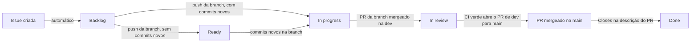

# Plano de Trabalho: Portfólio & Sistema de Gerenciamento

> Documento da **Fase 1 (planejamento)**. Descreve como o trabalho de construção é organizado: o fluxo de uma issue até o merge, o quadro no GitHub, as convenções e a ordem das issues.
> Veja também: [`escopo.md`](./escopo.md) · [`modelo-conceitual.md`](./modelo-conceitual.md) · [`casos-de-uso.md`](./casos-de-uso.md) · [`requisitos.md`](./requisitos.md)

---

## 1. Visão Geral

O sistema é construído por **issues pequenas**, cada uma com uma entrega que dá para testar em cerca de um dia de trabalho. Cada issue nasce dos requisitos (`RF`, `RN`, `RNF`) e dos casos de uso (`UC`) deste planejamento, e é acompanhada num quadro do GitHub Projects que se atualiza sozinho a partir das branches, do CI e dos merges.

O trabalho é feito por uma pessoa só, com **uma issue em andamento por vez**.

### 1.1 O que este documento cobre e o que não cobre

| Cobre | Não cobre |
|---|---|
| Fluxo de trabalho, colunas do quadro e o que move cada uma | Status e datas reais de cada issue: a fonte de verdade é o quadro |
| Campos, escalas, labels e padrão de escrita das issues | Decisões de tecnologia (Next.js, NestJS, Prisma, sessão no Redis, upload externo): ficam no `arquitetura.md`, da Fase 2 |
| A lista ordenada das issues do projeto e a divisão delas em semanas, com estimativa inicial | O ritmo real de cada semana: a divisão é recalibrada com as datas do quadro |

---

## 2. Fluxo de Trabalho

### 2.1 Branches

| Branch | Papel |
|---|---|
| `main` | Código entregue. Só muda por pull request vindo da `dev`. Não aceita push direto. |
| `dev` | Integração. Recebe o merge das branches de trabalho e roda o CI a cada push. |
| `tipo/<número>-slug` | Uma por issue, criada a partir da `dev` (exemplo: `feat/12-login-sessao`). O número é o **número real da issue no GitHub**: é por ele que os workflows acham o card. |

Os tipos de branch seguem o tipo do commit: `feat`, `fix`, `chore`, `docs`, `ci`.

### 2.2 Da issue ao Done

1. **Criar a issue** no GitHub, com o título prefixado pela área e o texto no padrão da seção 6. A automação do Project a coloca em *Backlog*.
2. **Criar a branch** a partir da `dev`, com o número real da issue no nome, e dar o primeiro push. O workflow `project-branch-status.yml` move o card: para *Ready* se a branch ainda não tem commits além da `dev`, ou para *In progress* se já tem.
3. **Trabalhar e commitar** na branch, no padrão da seção 7.
4. **Abrir o PR da branch para a `dev`** e mergear com **Create a merge commit**. O CI encontra as issues pelo texto do commit de merge ("Merge pull request #N from usuário/branch"), então squash e rebase não são usados aqui.
5. **O CI roda na `dev`**, a cada push:
   - descobre as issues que entraram na `dev` e ainda não estão na `main`;
   - move os cards delas para *In review*;
   - roda `lint`, `check-types`, `test` e `build` pelo Turborepo;
   - se tudo passar, abre (ou atualiza) o PR `dev` para `main`, com um `Closes #N` por issue.
6. **Mergear o PR `dev` para `main`.** As issues fecham pelo `Closes`, e a automação nativa do Project move os cards para *Done*.

Os cards só andam **para frente**, nunca para trás.

### 2.3 Quando o CI falha na `dev`

O card fica em *In review* (a issue ainda não está pronta), nenhum PR para a `main` é aberto, e o commit fica marcado como falho. A correção é da **mesma issue**, sem abrir outra:

| Situação | O que fazer |
|---|---|
| Correção pequena (lint, tipo, teste quebrado) | Commit direto na `dev`. O CI recalcula tudo a cada push, e o próximo verde abre ou atualiza o PR. |
| Correção maior | Branch `fix/<número>-slug` com PR para a `dev` |
| Defeito achado depois que a issue foi para *Done*, ou que não pertence a nenhuma issue | Issue nova, com a label `bug` |

---

## 3. Quadro (GitHub Projects)

### 3.1 Colunas

| Coluna | O que significa | Quem move |
|---|---|---|
| **Backlog** | Issue criada, ainda sem branch | Automação do Project |
| **Ready** | Branch criada, sem commits além da `dev` | Workflow `project-branch-status.yml` |
| **In progress** | Branch com commits além da `dev` | Workflow `project-branch-status.yml` |
| **In review** | Issue já está na `dev`, esperando o CI e o PR para a `main` | Job `in-review` do `ci.yml` |
| **Done** | Issue fechada pelo PR mergeado na `main` | Automação do Project |

### 3.2 Regras de uso

- Criar no *Backlog* **só as issues da semana** (seção 9), no começo dela. Texto de issue criado cedo demais envelhece, e o quadro fica entupido.
- Manter **uma** issue em *In progress* por vez.

---

## 4. Campos e Escalas

| Campo | Valores |
|---|---|
| **Priority** | **P0:** bloqueia outras issues (base, banco, autenticação, arquivos). **P1:** funcionalidade principal (painel, páginas públicas, certificados, GitHub, CD e deploy). **P2:** acabamento (revisão de responsividade e documentos da Fase 2). |
| **Size** | **XS:** até 1h. **S:** 2 a 4h. **M:** 5 a 8h (um dia). **L:** 2 a 3 dias. **XL:** mais de 3 dias (a issue deve ser quebrada). |
| **Estimate** | Horas de trabalho focado para terminar a issue. |
| **Start date** | Dia em que a issue saiu do *Backlog*. Gravada pelo `project-branch-status.yml`, só se estiver vazia. |
| **Target date** | Dia da conclusão. Gravada pelo `cd.yml` no merge na `main`, só se estiver vazia. |

Cada issue também leva **Assignees** (o próprio autor) e as labels da seção 5.

---

## 5. Labels

Cada issue leva **1 label de tipo** e **1 de área**. Prioridade e tamanho não viram label, porque já são campos do Project.

### 5.1 Tipo

| Label | Uso |
|---|---|
| `enhancement` | Funcionalidade nova |
| `chore` | Infraestrutura, configuração, CI, seed, deploy: tarefas sem funcionalidade nova para o usuário |
| `documentation` | Documentação |
| `bug` | Correção de defeito |

### 5.2 Área

| Label | Descrição |
|---|---|
| `area: base` | Monorepo, ambiente e conexão com banco e Redis |
| `area: banco` | Modelos, migrations e seed do banco (Prisma e PostgreSQL) |
| `area: auth` | Login, sessão no Redis, logout, papéis `ADMIN` e `GUEST`, CORS e CSRF |
| `area: arquivos` | Armazenamento externo e upload de imagens e PDF |
| `area: painel` | Telas do Painel de Controle (`ADMIN` e `GUEST`) |
| `area: publico` | Páginas públicas: projetos, perfil, certificados e currículo |
| `area: github` | Sincronização de releases pelo Webhook do GitHub |
| `area: deploy` | CD das imagens, deploy e HTTPS em produção |
| `area: docs` | Documentação da Fase 2: arquitetura, API, infraestrutura e README |

---

## 6. Padrão das Issues

- **Título:** prefixado pela área, no formato `Área: o que será feito` (exemplo: `Banco: Releases`).
- **Corpo**, sempre nesta ordem:
  1. **Descrição:** o que a issue entrega e por quê.
  2. **Tarefas:** lista de caixinhas `- [ ]`.
  3. **Critérios de aceite:** o que precisa ser verdade para a issue estar pronta.
  4. **Fora desta issue:** o que fica para outras issues.
  5. **Referências:** os `RF`, `RN`, `RNF` e `UC` que a originam.
- **Tamanho:** uma entrega testável em cerca de um dia. Issue grande demais (XL) é quebrada.
- **Critérios em toda issue:** o CI da `dev` passa (lint, tipos, testes e build). As issues de interface também são responsivas, mostram mensagens de erro claras e tratam o estado vazio sem erro.
- **Referências entre issues:** pelo **nome**, e não por `#número`. O GitHub numera issues e pull requests na mesma sequência, e o `#N` vira link para o item que tiver aquele número, que pode ser um PR.

---

## 7. Commits

Mensagens no padrão `tipo: descrição curta`, em português, no imperativo ou no presente:

| Tipo | Uso |
|---|---|
| `feat` | Funcionalidade nova |
| `fix` | Correção |
| `docs` | Documentação |
| `chore` | Configuração e tarefas de manutenção |
| `ci` | Workflows do GitHub Actions |

Exemplo: `feat: adiciona login com sessão no Redis`.

---

## 8. Backlog

Lista ordenada das issues do projeto. O **Nº** é só a ordem do plano: o número da issue no GitHub sai na criação e não é o mesmo. A estimativa em horas é **inicial** e deve ser recalibrada depois das primeiras issues, comparando com as datas reais no quadro. O status de cada issue fica no quadro, não aqui.

| Nº | Issue | Área | Prioridade | Estimativa (h) | Referências |
|---|---|---|---|---|---|
| 1 | Base: monorepo com web e api (feita) | base | P0 | 3 | RNF-08 |
| 2 | Base: conectar a api ao banco e ao Redis | base | P0 | 6 | RNF-08 |
| 3 | Banco: `Perfil` e `Usuarios`, tirando os modelos de exemplo | banco | P0 | 5 | RN-06, RN-10, RN-15, RN-19, RNF-09, RNF-10, RNF-13 |
| 4 | Banco: `Tecnologias`, `Projetos` e `Projeto_Tecnologias` | banco | P0 | 6 | RN-01, RN-09, RN-12, RN-13, RN-17, RN-18, RNF-13 |
| 5 | Banco: `Releases` | banco | P0 | 3 | RN-03, RN-11 |
| 6 | Banco: `Certificados` | banco | P0 | 4 | RN-02, RN-14 |
| 7 | Banco: seed do perfil e das contas `ADMIN` e `GUEST` | banco | P0 | 4 | RN-01, RN-02, RN-06, RN-08, RNF-01, RNF-08 |
| 8 | Auth: login com e-mail e senha e sessão no Redis | auth | P0 | 8 | RF-20, RF-22, RNF-01, RNF-05, RNF-17 |
| 9 | Auth: logout e expiração da sessão | auth | P0 | 3 | RF-42 |
| 10 | Auth: proteção das rotas do painel | auth | P0 | 5 | RF-23, RNF-02 |
| 11 | Auth: papéis no servidor e "Entrar como convidado" | auth | P0 | 5 | RF-21, RF-24, RF-26, RN-22, RN-23, RNF-03, RNF-04 |
| 12 | Auth: CORS com credenciais e proteção contra CSRF | auth | P0 | 4 | RNF-03, RNF-04 |
| 13 | Painel: estrutura com telas em modo leitura | painel | P0 | 6 | RF-25 |
| 14 | Arquivos: armazenamento externo e endpoint de upload | arquivos | P0 | 8 | RF-44, RF-45, RNF-20 |
| 15 | Painel: tecnologias (listar, criar e editar) | painel | P1 | 7 | RF-32, RF-35, RF-44, RF-45 |
| 16 | Painel: excluir tecnologia | painel | P1 | 3 | RF-31, RN-18 |
| 17 | Painel: editar perfil e currículo | painel | P1 | 6 | RF-35, RF-43, RF-44, RF-45 |
| 18 | Painel: listar projetos | painel | P1 | 4 | RF-27 |
| 19 | Painel: criar projeto | painel | P1 | 8 | RF-28, RF-29, RF-35, RF-44, RF-45, RN-04, RN-09, RNF-12 |
| 20 | Painel: editar projeto e destaque | painel | P1 | 6 | RF-27, RF-30, RF-35, RN-04, RNF-12 |
| 21 | Painel: excluir projeto | painel | P1 | 3 | RF-31, RN-17, RNF-12 |
| 22 | Público: menu e navegação a 1 clique | publico | P1 | 5 | RNF-14, RNF-16 |
| 23 | Público: vitrine de projetos | publico | P1 | 6 | RF-01, RF-07 |
| 24 | Público: destaques no topo | publico | P1 | 2 | RF-02 |
| 25 | Público: rota por *slug* e página "não encontrado" | publico | P1 | 4 | RF-03, RF-08 |
| 26 | Público: visão geral do projeto | publico | P1 | 5 | RF-04 |
| 27 | Público: seção "Como Fiz" | publico | P1 | 5 | RF-05, RF-07 |
| 28 | Público: histórico de releases | publico | P1 | 4 | RF-06, RF-07 |
| 29 | Painel: gerenciar releases | painel | P1 | 6 | RF-31, RF-34, RF-35 |
| 30 | GitHub: endpoint do Webhook com verificação | github | P1 | 6 | RF-36, RF-41, RNF-06 |
| 31 | GitHub: registrar sem duplicar e descartar repositório desconhecido | github | P1 | 5 | RF-37 a RF-40 |
| 32 | GitHub: configurar o Webhook num repositório real e testar | github | P1 | 4 | UC-16 |
| 33 | Público: resumo e contato do perfil | publico | P1 | 4 | RF-09, RF-10 |
| 34 | Público: habilidades por área | publico | P1 | 4 | RF-11 |
| 35 | Público: botão de baixar currículo | publico | P1 | 3 | RF-12, RF-13 |
| 36 | Certificados: mural | publico | P1 | 5 | RF-07, RF-14 |
| 37 | Certificados: filtro por categoria | publico | P1 | 3 | RF-15, RF-16 |
| 38 | Certificados: modal de detalhes (grade, comprovante e link) | publico | P1 | 5 | RF-17 a RF-19 |
| 39 | Painel: gerenciar certificados | painel | P1 | 7 | RF-31, RF-33, RF-35, RF-44, RF-45 |
| 40 | Revisão de responsividade e imagens otimizadas | publico | P2 | 8 | RNF-15, RNF-18 |
| 41 | CD: construir e publicar as imagens da api e do web | deploy | P1 | 6 | `escopo.md` §8.2 |
| 42 | Deploy e HTTPS em produção | deploy | P1 | 8 | RNF-07 |
| 43 | Docs: `arquitetura.md` | docs | P2 | 3 | `escopo.md` §8.2 |
| 44 | Docs: `api.md` | docs | P2 | 3 | `escopo.md` §8.2 |
| 45 | Docs: `infraestrutura-e-deploy.md` | docs | P2 | 3 | `escopo.md` §8.2 |
| 46 | Docs: `README.md` | docs | P2 | 2 | `escopo.md` §8.2 |

São **46 issues**, somando **223 horas** de estimativa inicial. Num ritmo de cerca de 15 horas por semana, são aproximadamente 15 semanas. A divisão em semanas está na seção 9.

---

## 9. Divisão por Semana

As 45 issues que faltam estão distribuídas em **15 semanas**, com **13 a 16 horas** em cada uma, para o ritmo ficar equilibrado. A divisão segue três critérios:

- **Dependência:** base, banco e autenticação vêm antes das telas que usam esses dados.
- **Equilíbrio:** nenhuma semana passa de 16 horas nem fica abaixo de 13.
- **Fim do ciclo:** configurar o Webhook num repositório real (issue 32) fica na última semana, porque exige uma URL pública, e os documentos da Fase 2 só podem ser escritos com o sistema pronto.

**Como usar:** no começo de cada semana, criar no *Backlog* só as issues dela. A issue 1 já está feita. Na semana 1, a issue 2 já está no *Backlog*, e faltam criar a 3 e a 7.

**Semana 1 (15h)**
- 2 · Base: conectar a api ao banco e ao Redis (6h)
- 3 · Banco: `Perfil` e `Usuarios`, tirando os modelos de exemplo (5h)
- 7 · Banco: seed do perfil e das contas `ADMIN` e `GUEST` (4h)

**Semana 2 (13h)**
- 4 · Banco: `Tecnologias`, `Projetos` e `Projeto_Tecnologias` (6h)
- 5 · Banco: `Releases` (3h)
- 6 · Banco: `Certificados` (4h)

**Semana 3 (15h)**
- 8 · Auth: login com e-mail e senha e sessão no Redis (8h)
- 9 · Auth: logout e expiração da sessão (3h)
- 12 · Auth: CORS com credenciais e proteção contra CSRF (4h)

**Semana 4 (16h)**
- 10 · Auth: proteção das rotas do painel (5h)
- 11 · Auth: papéis no servidor e "Entrar como convidado" (5h)
- 13 · Painel: estrutura com telas em modo leitura (6h)

**Semana 5 (15h)**
- 14 · Arquivos: armazenamento externo e endpoint de upload (8h)
- 15 · Painel: tecnologias (listar, criar e editar) (7h)

**Semana 6 (13h)**
- 16 · Painel: excluir tecnologia (3h)
- 17 · Painel: editar perfil e currículo (6h)
- 18 · Painel: listar projetos (4h)

**Semana 7 (14h)**
- 19 · Painel: criar projeto (8h)
- 20 · Painel: editar projeto e destaque (6h)

**Semana 8 (14h)**
- 21 · Painel: excluir projeto (3h)
- 22 · Público: menu e navegação a 1 clique (5h)
- 23 · Público: vitrine de projetos (6h)

**Semana 9 (16h)**
- 24 · Público: destaques no topo (2h)
- 25 · Público: rota por *slug* e página "não encontrado" (4h)
- 26 · Público: visão geral do projeto (5h)
- 27 · Público: seção "Como Fiz" (5h)

**Semana 10 (16h)**
- 28 · Público: histórico de releases (4h)
- 29 · Painel: gerenciar releases (6h)
- 30 · GitHub: endpoint do Webhook com verificação (6h)

**Semana 11 (16h)**
- 31 · GitHub: registrar sem duplicar e descartar repositório desconhecido (5h)
- 33 · Público: resumo e contato do perfil (4h)
- 34 · Público: habilidades por área (4h)
- 35 · Público: botão de baixar currículo (3h)

**Semana 12 (13h)**
- 36 · Certificados: mural (5h)
- 37 · Certificados: filtro por categoria (3h)
- 38 · Certificados: modal de detalhes (grade, comprovante e link) (5h)

**Semana 13 (15h)**
- 39 · Painel: gerenciar certificados (7h)
- 40 · Revisão de responsividade e imagens otimizadas (8h)

**Semana 14 (14h)**
- 41 · CD: construir e publicar as imagens da api e do web (6h)
- 42 · Deploy e HTTPS em produção (8h)

**Semana 15 (15h)**
- 32 · GitHub: configurar o Webhook num repositório real e testar (4h)
- 43 · Docs: `arquitetura.md` (3h)
- 44 · Docs: `api.md` (3h)
- 45 · Docs: `infraestrutura-e-deploy.md` (3h)
- 46 · Docs: `README.md` (2h)

Depois das semanas 1 e 2, comparar as horas estimadas com as reais (Start date, Target date e Estimate no quadro) e redistribuir as semanas seguintes se o ritmo for diferente.

---

## 10. Premissas e Pontos em Aberto

1. **Estimativas.** As horas são um palpite inicial. Depois das primeiras issues, a comparação entre **Start date**, **Target date** e **Estimate** no quadro ajusta o resto do backlog.
2. **Datas automáticas.** A Start date depende do ajuste no `project-branch-status.yml`, e a Target date depende do `cd.yml`. Enquanto esses arquivos não estiverem no repositório, as duas datas são preenchidas à mão.
3. **Ritmo.** O ritmo de 15 horas por semana é uma premissa. Com outro ritmo, só a duração total muda, e a ordem das issues continua a mesma.
4. **Hospedagem.** Ainda não definida. Ela afeta a configuração do Webhook num repositório real (issue 32) e o deploy (issue 42), que precisam de uma URL pública.
5. **Nome do documento de infraestrutura.** O `escopo.md` cita `infraestrutura-e-deploy.md`, e o arquivo vazio hoje no repositório se chama `infraestrutura.md`. O nome é acertado quando o documento for escrito (issue 45).